<div align="center">


# Mio

**Your anime and manga, ready when you are.**

Open Mio, see what's next, log your progress, and close it again in under 30 seconds. ⏱️


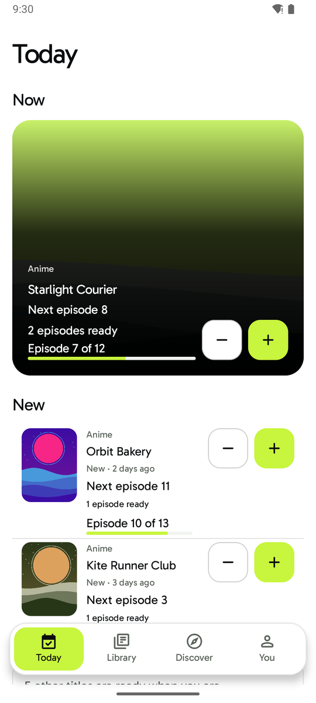&nbsp;
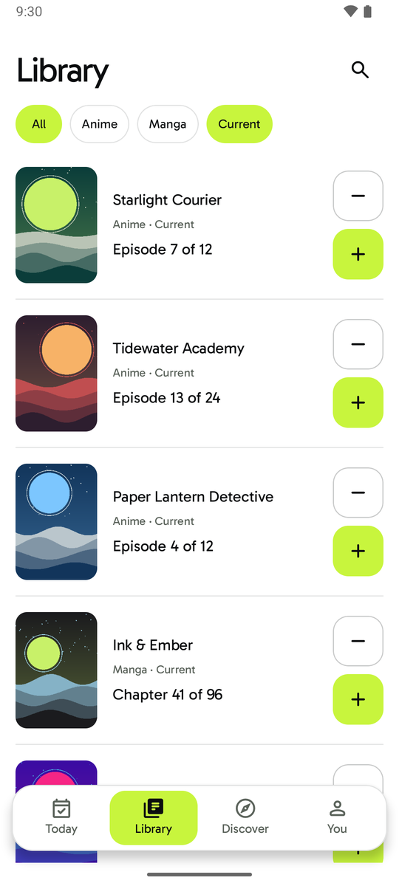&nbsp;
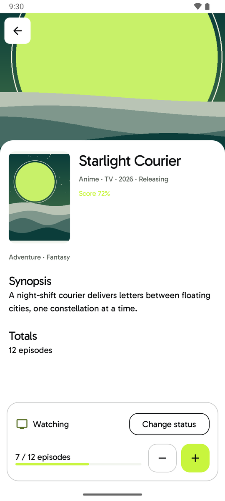

</div>

---

## ✨ Why Mio?

If you follow 15 to 50 shows and series at a time, AniList and MyAnimeList already hold all of your data. The tedious part is the everyday routine: scrolling a long list, remembering what came out this week, working out which episode is next, and going through several screens just to add one episode.

Mio turns that big collection into a **short daily queue**:

- 🎯 **Know what's next.** Today shows the best thing to watch or read right now, plus anything newly released.
- ➕ **One-tap progress.** `+1` / `−1` right on the card, with Undo when you slip.
- 📴 **Offline-first.** Every change is saved locally first, then synced to your provider in the background.
- 🔗 **No new account.** Sign in with the AniList or MyAnimeList account you already use. That provider remains the source of truth.
- 🌗 **Calm and polished.** Light and dark themes, generous touch targets, and reduced-motion support.

## 📱 A quick tour

| | | |
| :---: | :---: | :---: |
| 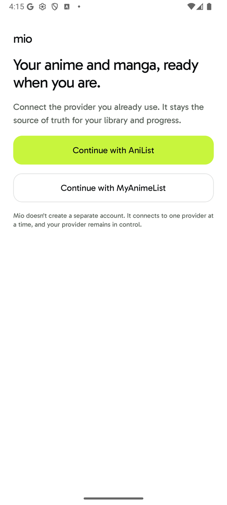 |  |  |
| **👋 Onboarding**<br/>Connect AniList or MyAnimeList, nothing else to set up. | **📅 Today**<br/>Your *Now* card and new releases, ready for `+1`. | **📚 Library**<br/>Your full collection, filterable by type and status. |
| 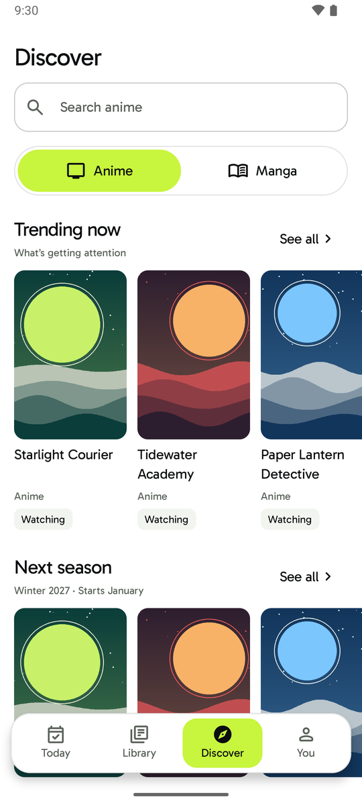 |  | 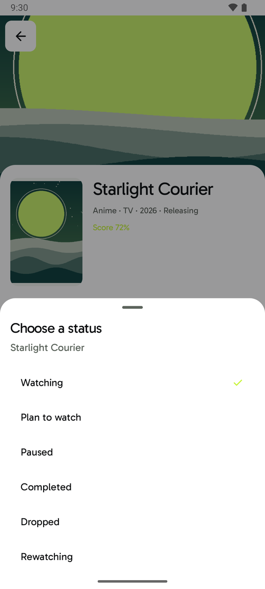 |
| **🧭 Discover**<br/>Search, trending lists and the upcoming season. | **🎬 Media detail**<br/>Synopsis, totals and a persistent tracking dock. | **🏷️ Status sheet**<br/>Change status in one tap. |
| 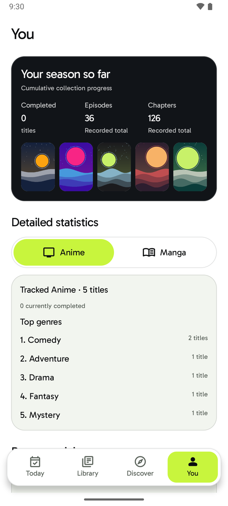 | 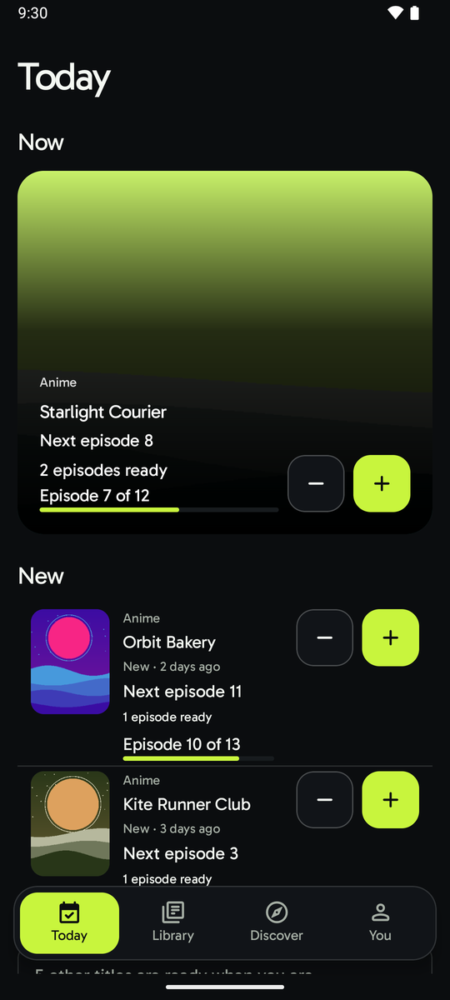 | 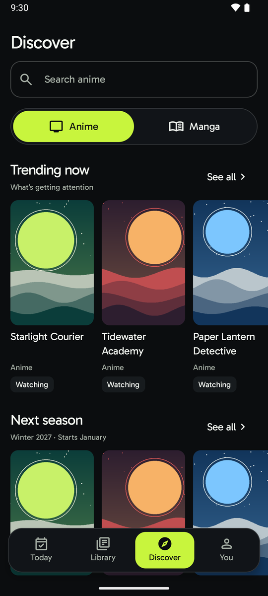 |
| **🙋 You**<br/>Your season so far, stats and preferences. | **🌙 Dark theme**<br/>Same layout, easier on the eyes at night. | **🌙 Dark Discover**<br/>The lime accent stands out on dark surfaces too. |

> 🖼️ All titles, posters and accounts in these screenshots are fictional. They come from the local [fixture provider](tools/fixture-provider/), not from AniList or MyAnimeList.

## 🏗️ Architecture

Mio is a multi-module, offline-first Android app. Feature modules know nothing about providers, databases or each other's internals. Everything goes through domain contracts, and the architecture rules are **enforced by tests** in [`architecture-tests`](architecture-tests/) (Konsist).

### Module layers

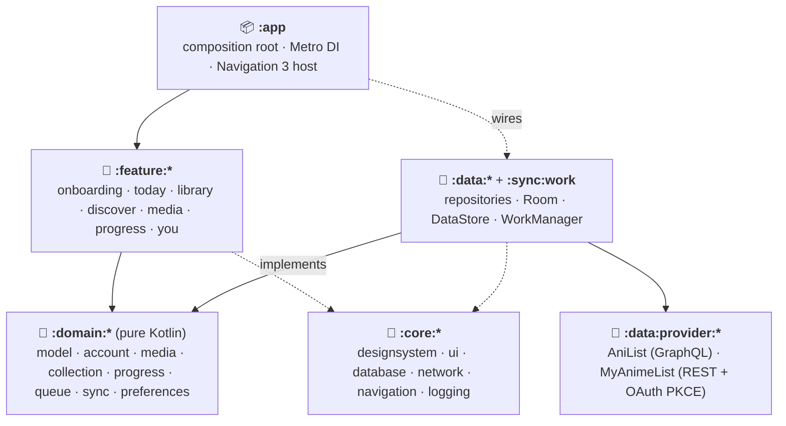

### How a `+1` travels

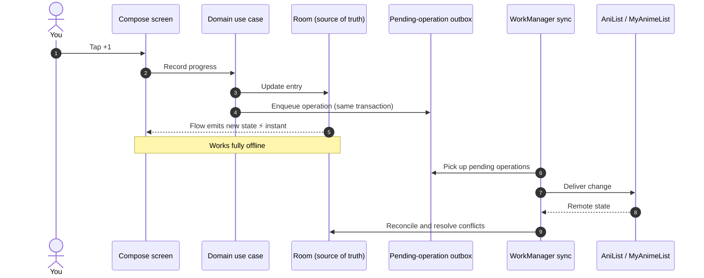

More detail lives in the design docs:

| Doc | What's inside |
| --- | --- |
| 📘 [PRD](docs/PRD.md) | Product vision, target user, core session, scope |
| 🎨 [DESIGN](docs/DESIGN.md) | Tokens, components, motion, accessibility |
| 🏛️ [ARCHITECTURE](docs/ARCHITECTURE.md) | Modules, dependency rules, persistence, sync, DI, navigation |
| 🛠️ [ENGINEERING](docs/ENGINEERING.md) | Kotlin source organisation and conventions |
| 🖌️ [Design samples](docs/samples/) and [motion prototypes](prototypes/) | Approved concept art and interactive motion references |

## 🧰 Tech stack

| Area | Tools |
| --- | --- |
| Language & UI | Kotlin 2.3, Jetpack Compose, Material 3, Gabarito typeface |
| Architecture | Multi-module Clean Architecture, unidirectional state, Route/Screen split |
| DI & navigation | [Metro](https://github.com/ZacSweers/metro), Navigation 3 |
| Persistence | Room (single source of truth), DataStore, Android Keystore-encrypted credentials |
| Networking | Retrofit, OkHttp, kotlinx.serialization, Coil 3 for artwork |
| Background work | WorkManager with a durable outbox |
| Time | kotlinx-datetime (no `java.time` in domain) |
| Quality | JUnit 5, MockWebServer, Room migration tests, Konsist architecture rules, ktlint, Android Lint, dependency guard |

## 🚀 Getting started

### Prerequisites

- ☕ **JDK 21**
- 🤖 **Android SDK 37** (Android Studio or the `android` CLI)
- 📱 A device or emulator running Android 11 (API 30) or newer

### 1. Register your own OAuth clients

Mio has no backend and **ships no client IDs or secrets**. Register a client with each provider you want to use:

| Provider | Where | Redirect URI |
| --- | --- | --- |
| AniList | [anilist.co/settings/developer](https://anilist.co/settings/developer) | `mio://oauth/anilist` |
| MyAnimeList | [myanimelist.net/apiconfig](https://myanimelist.net/apiconfig) | `mio://oauth/myanimelist` |

### 2. Add the client IDs locally

Put them in `local.properties` (git-ignored):

```properties
mio.anilist.clientId=your-anilist-client-id
mio.myanimelist.clientId=your-myanimelist-client-id
```

You can also pass them as Gradle properties (`-Pmio.anilist.clientId=…`) or set the environment variables `MIO_ANILIST_CLIENT_ID` / `MIO_MYANIMELIST_CLIENT_ID`. If one is missing, that provider shows as unavailable in the build.

### 3. Build & run

```bash
./gradlew :app:installDebug
```

## 🧪 Quality gate

One command runs formatting checks, lint, every unit test, the dependency guard and the architecture rules, then assembles the app:

```bash
./gradlew verify
```

Useful on their own:

```bash
./gradlew format          # ktlint auto-format
./gradlew konsistCheck    # architecture rules only
```

Want to try the app without a real account? 🧪 The [fixture provider](tools/fixture-provider/) runs a fake AniList/MyAnimeList on your machine with a fictional collection. It's what produced the screenshots above.

## 🗺️ Project status

Mio is in **beta** (`0.1.0`). The MVP covers both providers, the daily progress loop, Library, Discover search and browsing, media detail, status changes, offline sync with recovery, and account and preferences. The [PRD](docs/PRD.md) describes what comes after.

## 📄 License

**Copyright © 2026 mosmb. All rights reserved.**

This repository is **source-available, not open source**. You're welcome to read the code and learn from it, but you may not copy, modify, redistribute or publish the app (including to app stores) without written permission. See [LICENSE](LICENSE).

Bundled third-party assets keep their own licenses. The Gabarito font is under the SIL OFL 1.1 and Material Symbols under Apache 2.0; see the `THIRD_PARTY_NOTICES.md` files.

## 🙏 Acknowledgements

- [AniList](https://anilist.co) and [MyAnimeList](https://myanimelist.net) for their public APIs. Mio is an independent project and is **not affiliated with or endorsed by** either service.
- [Gabarito](https://fonts.google.com/specimen/Gabarito) and [Material Symbols](https://fonts.google.com/icons) from Google Fonts.

<div align="center">
<sub>Made with 💚 for people with too many shows and not enough time.</sub>
</div>
