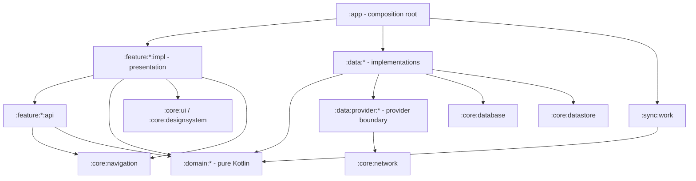

# Mio Architecture

**Status:** Normative architecture contract  
**Applies to:** Android v0 and all subsequent changes unless superseded by an accepted architecture decision  
**Product requirements:** [`PRD.md`](./PRD.md)  
**Application ID:** `io.morgan.mio`  
**Minimum Android SDK:** 30

## 1. Purpose and authority

This document defines how Mio MUST be built. It is an implementation contract for humans and coding agents, not a general description of possible approaches.

The terms **MUST**, **MUST NOT**, **SHOULD**, **SHOULD NOT**, and **MAY** are normative:

- **MUST / MUST NOT**: mandatory. A violation is an implementation defect.
- **SHOULD / SHOULD NOT**: the default. A deviation requires a documented reason.
- **MAY**: optional and permitted within all other constraints.

When requirements conflict, use this order of authority:

1. The current explicit user instruction.
2. `PRD.md` for product behavior.
3. This document for implementation architecture.
4. An accepted Architecture Decision Record (ADR).
5. Existing code patterns that comply with the sources above.

An implementation MUST NOT weaken an architecture check merely to make a change pass. If a required product change conflicts with this document, update the document, the relevant ADR, and the automated enforcement in the same change.

## 2. Architectural principles

Mio uses Clean Architecture with strict boundaries:

```text
presentation -> domain <- data
```

- Presentation depends on domain.
- Data depends on domain.
- Domain depends on neither presentation nor data.
- Domain is pure Kotlin and has no Android dependency.
- Room is the sole runtime source of truth for product and content state.
- Network responses never bypass Room on their way to the UI.
- Each architectural layer owns its own models.
- Repositories aggregate data sources and contain no product business logic.
- Use cases exist only when they contain business logic or meaningful orchestration.
- Features are user-facing capabilities with Navigation 3 `api` and `impl` modules.
- Module boundaries are enforced by Gradle and Konsist, not documentation alone.

The design goals are high cohesion, low coupling, offline-first behavior, deterministic state, compile-time dependency validation, and implementation patterns simple enough for an agent to reproduce consistently.

## 3. Approved technology baseline

The following choices are mandatory unless changed through an architecture decision:

| Concern | Required choice |
|---|---|
| Language | Kotlin |
| UI | Jetpack Compose |
| Navigation | Navigation 3 only |
| Local relational storage | Room |
| Preferences | DataStore |
| Network | Retrofit and OkHttp |
| Serialization | `kotlinx.serialization` |
| Dependency injection | Metro native APIs |
| Async/reactive | Kotlin coroutines, `Flow`, `StateFlow`, `SharedFlow` |
| Durable background work | WorkManager |
| Image loading | Coil |
| Debug logging | Timber, debug builds only |
| Architecture enforcement | Konsist plus Gradle module boundaries |
| Formatting | ktlint |
| Platform | Android phone/tablet application, `minSdk = 30` |

The following are forbidden:

- Navigation 1 or Navigation 2 APIs.
- Hilt, Dagger, Koin, or a service locator.
- Gson, Moshi, Jackson, or Java serialization.
- RxJava.
- Paging 3. Pagination, if required, MUST be implemented in-house according to this architecture.
- `java.time`, `java.util.Date`, and `Calendar` in project code.
- `GlobalScope` or unmanaged application scopes.
- Dynamic dependency versions.
- Dynamic-feature modules, Wear, TV, Auto, or multiplatform targets without a new product requirement and architecture decision.

Visual design choices are deliberately out of scope. This document defines Compose structure and ownership, not colors, typography, Material styling, or visual direction.

## 4. Project and module structure

The project MUST use the following module families:

```text
mio/
├── app/
├── build-logic/
├── architecture-tests/
│
├── feature/
│   ├── onboarding/{api,impl}
│   ├── today/{api,impl}
│   ├── library/{api,impl}
│   ├── discover/{api,impl}
│   ├── you/{api,impl}
│   ├── media/{api,impl}
│   └── progress/{api,impl}
│
├── domain/
│   ├── model/
│   ├── account/
│   ├── media/
│   ├── collection/
│   ├── progress/
│   ├── queue/
│   ├── sync/
│   └── preferences/
│
├── data/
│   ├── account/
│   ├── media/
│   ├── collection/
│   ├── progress/
│   ├── sync/
│   ├── preferences/
│   └── provider/
│       ├── api/
│       ├── anilist/
│       └── myanimelist/
│
├── core/
│   ├── common/
│   ├── database/
│   ├── datastore/
│   ├── network/
│   ├── designsystem/
│   ├── ui/
│   ├── navigation/
│   ├── logging/
│   └── testing/
│
└── sync/
    └── work/
```

Do not create modules for hypothetical reuse. A new module requires a cohesive responsibility, a real dependency boundary, and an update to this document and the architecture checks.

### 4.1 Namespace convention

All namespaces derive from `io.morgan.mio`:

```text
io.morgan.mio.feature.today.api
io.morgan.mio.feature.today.impl
io.morgan.mio.domain.progress
io.morgan.mio.data.provider.anilist
io.morgan.mio.core.database
```

Source packages MUST reflect module ownership. Code MUST NOT be placed in a misleading package to bypass an architecture rule.

### 4.2 App module

`:app` is the Android entry point and composition root. It owns:

- The `Application` and main `Activity`.
- Creation and lifetime of the root Metro graph.
- Root Navigation 3 state and `NavDisplay`.
- The authenticated/unauthenticated root switch.
- The four top-level navigation stacks.
- Assembly of feature implementations and data implementations.
- Build-type-specific initialization.

`:app` MUST NOT contain feature business logic, repository implementations, Room queries, Retrofit services, or reusable UI components.

### 4.3 Feature modules

Every user-facing capability has both `api` and `impl` from v0.

An `api` module contains only what other features need to navigate to the capability:

- Serializable Navigation 3 keys.
- Typed navigation arguments.
- Minimal top-level destination metadata when required.
- Small public result contracts when navigation genuinely returns a result.

An `api` module MUST NOT contain Composables, ViewModels, UI state, repositories, data sources, domain logic, or implementation details.

An `impl` module contains:

- Navigation 3 entry builders.
- Routes and Screens.
- ViewModels.
- Feature-owned UI state, UI models, actions, events, and mappers.
- Feature-specific Compose components.
- Metro contributions belonging to presentation.

Cross-feature dependencies follow this rule:

```text
feature X impl -> feature Y api     allowed
feature X impl -> feature Y impl    forbidden
feature X api  -> feature Y impl    forbidden
```

The app module sees every feature implementation so it can compose the application. A feature implementation sees only destination API modules for cross-feature navigation.

### 4.4 Feature responsibilities

#### Onboarding

`:feature:onboarding` owns provider selection, OAuth connection, initial synchronization presentation, authentication errors, and entry into the authenticated app.

#### Today

`:feature:today` owns the Now card, New cards, remaining-ready summary, caught-up receipt, direct progress-action presentation, and protection against visual queue replacement during active interaction.

#### Library

`:feature:library` owns the complete collection presentation, status/media/Ready filters, sorting, remembered filter interaction, and direct progress-action presentation.

#### Discover

`:feature:discover` owns search input, search request presentation, normalized cached results, and navigation to media details.

#### You

`:feature:you` owns provider identity presentation, recent activity, synchronization state, actionable failures, preferences, disconnection, and sign out. Settings and synchronization details remain within this feature until they become substantial independent capabilities.

#### Media

`:feature:media` owns the shared media-detail destination, essential media information, collection state, add/status editing, and entry into explicit progress editing.

#### Progress

`:feature:progress` owns the explicit progress editor, manual corrections, and correction-conflict resolution UI. It does not own every `+1` button.

### 4.5 Domain modules

Domain modules are pure Kotlin/JVM modules and MUST NOT apply an Android plugin or import Android/AndroidX APIs.

- `:domain:model`: provider-neutral models, typed IDs, value objects, and shared enums.
- `:domain:account`: account contracts and account business rules.
- `:domain:media`: media and release contracts and rules.
- `:domain:collection`: collection contracts and collection-status rules.
- `:domain:progress`: increment, correction, completion, and Undo logic.
- `:domain:queue`: Today eligibility, Now choice, New qualification, and Ready calculations.
- `:domain:sync`: synchronization contracts, operation intent, and reconciliation policies.
- `:domain:preferences`: preference models and repository contract.

Dependencies between domain modules MUST be explicit, minimal, and acyclic. `:domain:model` is the lowest domain module and depends on no other project layer.

### 4.6 Data modules

Capability data modules implement domain repository contracts and aggregate local, provider, credential, preference, or outbox data sources as appropriate.

- `:data:account`: account and account-session repositories, credential data source, and account persistence coordination.
- `:data:media`: media/release repository and local/provider media data sources.
- `:data:collection`: collection repository and local/provider collection data sources.
- `:data:progress`: progress repository and atomic progress persistence coordinated with the sync outbox writer.
- `:data:sync`: sync repository, pending-operation outbox data source and writer, remote snapshot access, operation delivery, and synchronization persistence coordination.
- `:data:preferences`: preference repository, DataStore data source, and mapping.

Provider isolation is physical:

- `:data:provider:api` defines data-layer-only provider data-source contracts and canonical provider data models.
- `:data:provider:anilist` owns AniList Retrofit services, DTOs, authentication behavior, capability handling, and mappings.
- `:data:provider:myanimelist` owns MyAnimeList Retrofit services, DTOs, authentication behavior, capability handling, and mappings.

Provider capability information, remote IDs, DTOs, status codes, error codes, pagination cursors, and API limitations MUST NOT escape data/network modules.

### 4.7 Core modules

- `:core:common`: small cross-cutting Kotlin utilities with proven multi-module use. It is not a dumping ground.
- `:core:database`: Room database, entities, DAOs, transactions, migrations, and type converters.
- `:core:datastore`: DataStore construction and serialized preference storage models.
- `:core:network`: shared Retrofit/OkHttp construction, serialization configuration, connectivity observation, and redacted network infrastructure.
- `:core:designsystem`: visual primitives, tokens, foundational reusable components, preview support, and accessibility defaults. It contains no product design specification in this document.
- `:core:ui`: reusable Mio-specific UI with at least two real feature consumers.
- `:core:navigation`: shared Navigation 3 state/manipulation contracts and top-level navigation infrastructure.
- `:core:logging`: project logging boundary and build-type implementations.
- `:core:testing`: fakes, fixtures, fake clocks/dispatchers, and reusable test assertions.

`core` does not mean “allowed to depend on everything.” Every core module MUST remain narrowly owned and low in the dependency graph.

### 4.8 Sync work module

`:sync:work` owns WorkManager integration only: Worker types, scheduling, constraints, and translation of domain sync outcomes to WorkManager outcomes. Workers MUST be thin and contain no reconciliation or product rules.

### 4.9 Architecture test module

`:architecture-tests` is an isolated JVM test module containing Konsist rules over the entire project. It MUST have a root `konsistCheck` task and MUST run whenever any production source module changes.

## 5. Dependency rules

The allowed dependency direction is:



Mandatory prohibitions:

- Domain MUST NOT depend on Android, presentation, data, Room, Retrofit, WorkManager, Navigation, Metro Android integration, or provider modules.
- Domain business code MUST NOT perform logging. Technical failures are logged at the outer boundary that handles them.
- Presentation MUST NOT depend on data modules, Room, Retrofit, DataStore, provider modules, DTOs, entities, or DAOs.
- Feature implementations MUST NOT depend on other feature implementations.
- Repositories MUST NOT depend on other repositories.
- Data modules MAY depend on another data module only when the dependency is listed in the data dependency matrix, remains acyclic, and uses a narrow data-source contract rather than the other module's repository implementation.
- Shared UI MUST NOT depend on features.
- Navigation keys MUST NOT contain data, domain aggregate, or UI model objects.
- App MUST NOT become a shortcut location for business logic.

### 5.1 Initial feature dependency matrix

Feature modules SHOULD depend on fewer modules when possible. The following matrix is the maximum intended v0 surface; adding another cross-feature or domain dependency requires updating the matrix and its Gradle/Konsist enforcement.

| Feature implementation | Own API | Other feature APIs allowed | Domain capabilities allowed |
|---|---|---|---|
| `onboarding` | `onboarding:api` | none; authenticated-root transition is owned by app | `account`, `sync`, `model` |
| `today` | `today:api` | `media:api`, `library:api` | `queue`, `progress`, `collection`, `preferences`, `model` |
| `library` | `library:api` | `media:api`, `progress:api` | `collection`, `progress`, `preferences`, `model` |
| `discover` | `discover:api` | `media:api` | `media`, `collection`, `model` |
| `you` | `you:api` | none | `account`, `sync`, `preferences`, `model` |
| `media` | `media:api` | `progress:api` | `media`, `collection`, `progress`, `model` |
| `progress` | `progress:api` | none | `progress`, `collection`, `sync`, `model` |

Every feature API may depend only on `:core:navigation`, `:domain:model` for typed IDs, Kotlin serialization, and Navigation 3 runtime APIs required to define keys. It MUST NOT depend on its implementation or on broader domain capabilities.

### 5.2 Initial data dependency matrix

| Data module | Domain dependencies | Infrastructure/data dependencies allowed |
|---|---|---|
| `data:account` | `account`, `model` | `core:database`, secure credential mechanism, `data:provider:api` |
| `data:media` | `media`, `model` | `core:database`, `data:provider:api` |
| `data:collection` | `collection`, `model` | `core:database`, `data:provider:api`, `data:sync` pending-operation writer only |
| `data:progress` | `progress`, `collection`, `model` | `core:database`, `data:provider:api`, `data:sync` pending-operation writer only |
| `data:sync` | `sync`, `model` | `core:database`, `data:provider:api` |
| `data:preferences` | `preferences`, `model` | `core:datastore` |

Provider implementation modules depend on `data:provider:api` and `core:network`. They MUST NOT depend on capability repository implementations. Capability data modules depend on the provider API, never directly on AniList or MyAnimeList implementations. `:app`/the Metro account graph supplies the chosen provider implementation.

`:data:sync` MUST NOT depend on `:data:progress` or `:data:collection`. Those mutation modules may depend on the narrow `PendingOperationWriter` exposed by `:data:sync`; they MUST NOT call `SyncRepository` or access sync delivery internals.

## 6. Model ownership and mapping

Each layer owns separate models:

```text
Retrofit DTO
    -> provider mapper
canonical provider data model
    -> persistence mapper
Room entity
    -> repository/data mapper
domain model
    -> feature presentation mapper
UI model
```

Rules:

- DTOs live in the owning provider module.
- Room entities live in `:core:database`.
- Provider-neutral data models live inside the data boundary.
- Domain models live in `:domain:model` or their owning domain capability.
- UI models live in the owning feature implementation.
- A model MUST NOT implement conversion into a lower layer, such as `DomainModel.toEntity()`.
- Mapping functions live in the layer that knows both source and target, normally the consuming outer layer.
- Mappers perform structural translation, normalization, and representation conversion. They MUST NOT contain product business decisions.
- UI formatting belongs to presentation.
- Raw provider types and IDs MUST NOT appear in domain or presentation.

All models are immutable. Mutable collections MUST NOT be exposed. Domain value objects SHOULD enforce intrinsic invariants; rules needing context, time, multiple models, or repositories belong in use cases.

## 7. Identity model

Domain and presentation use Mio-owned strongly typed opaque IDs:

```kotlin
@JvmInline value class MediaId(val value: String)
@JvmInline value class CollectionEntryId(val value: String)
@JvmInline value class OperationId(val value: String)
```

Use the actual required ID types; do not pass raw `String` or `Long` values through domain APIs when the value has an identity meaning.

Room maintains mappings between local IDs and provider IDs. Provider IDs stay inside data/network. Navigation keys use Mio IDs only. Provider identity may be exposed as account display information because the product displays the connected provider; provider capabilities MUST remain hidden.

## 8. Repository, data-source, and use-case rules

### 8.1 Repositories

Repository interfaces live in domain. Implementations live in data.

A repository MAY:

- Aggregate multiple data sources for the same cohesive data capability.
- Map data models to domain models.
- Coordinate source-of-truth consistency.
- Execute atomic persistence requested by a domain command.

A repository MUST NOT:

- Contain product business rules.
- Depend on another repository.
- Return DTOs, entities, Retrofit responses, DAOs, provider models, or Android types.
- Allow the network to become a parallel UI source.

### 8.2 Data sources

Every source or mechanism has its own focused data-source class. Examples include Room collection storage, AniList media access, MyAnimeList progress access, secure credential storage, DataStore preferences, and the pending-operation outbox.

A data source communicates with exactly one source/mechanism. It does not choose product behavior or aggregate unrelated sources.

### 8.3 Use cases

Use cases are optional. Create one only when it:

- Applies a business rule.
- Combines repositories or domain inputs.
- Coordinates a meaningful mutation.
- Makes a domain decision.

Do not create a use case that only forwards `repository.get()` or `repository.observe()`. ViewModels MAY depend directly on domain repository interfaces for simple observation/delegation.

Use cases use constructor injection and `operator fun invoke`. Do not create `BaseUseCase`, marker interfaces, or generic execution frameworks.

Examples:

```text
ViewModel -> MediaRepository.observeMedia(id)       no use case
ViewModel -> IncrementProgress                       use case
ViewModel -> ObserveTodayQueue                       use case
```

When a business action has multiple storage consequences, the use case decides the intended domain change and asks one repository operation to persist the complete change atomically. It MUST NOT emulate a transaction by calling several repository mutations sequentially.

A use case MAY coordinate multiple repository contracts when applying business logic. It MUST NOT access data sources or persistence transactions. Once the use case has decided the complete domain change, one repository command owns the atomic persistence boundary and may coordinate multiple focused data sources internally. This coordination is persistence consistency, not business logic.

## 9. Room as the sole runtime source of truth

Every screen observes Room-backed domain data. Retrofit responses and user mutations update Room; the UI never renders a raw network result.

The selected provider remains the remote authority for the connected collection, while Room is the app's runtime source of truth. Pending local operations represent user intent that has not yet been reconciled with that remote authority. This distinction MUST NOT be implemented as two competing UI data sources.

Room distinguishes:

- **Remote baseline:** the latest normalized state observed from the selected provider.
- **Effective local state:** the state rendered by Mio after applying pending local intent and reconciliation rules.
- **Pending operations:** durable user intent not yet reconciled with the remote baseline.

An incoming provider snapshot MUST NOT blindly overwrite effective state for an aggregate with pending operations. Applying a normalized remote snapshot MUST use one Room transaction that:

1. Persists the new remote baseline.
2. Loads pending operations for each affected aggregate.
3. Runs the pure domain reconciliation policy against the remote baseline, current effective state, and pending intent.
4. Updates effective state.
5. Updates pending-operation and conflict/sync-issue state.

When no pending operation affects an aggregate, its normalized remote baseline may directly become its effective local state. Partial or paginated snapshots MUST NOT be interpreted as remote deletion until the snapshot is known to be complete.

Repositories separate observation from refresh:

```kotlin
fun observeMedia(id: MediaId): Flow<Media?>
suspend fun refreshMedia(id: MediaId)
```

- Observe functions read Room only and have no hidden network side effects.
- Refresh functions fetch and persist; they do not return models for direct rendering.
- Cached data remains visible while refresh runs.
- Staleness policy belongs to data/sync, never ViewModels.
- Do not introduce a generic `Resource<T>` or `NetworkBoundResource` base abstraction.
- Discover results and query associations MAY be normalized into Room; request-loading state remains presentation state.

Room owns durable product/content state, including accounts, media, releases, collection entries, progress, pending operations, sync issues, recent activity, and relevant search cache.

### 9.1 Schema rules

- Export and commit Room schemas from version 1.
- Production MUST NOT use destructive migration fallback.
- Every schema change includes an explicit migration and a migration test.
- Use foreign keys, unique constraints, and indexes to enforce invariants.
- Multi-table changes and their outbox insertion occur in one Room transaction.
- Entities and DAOs do not escape database/data modules.
- Column names and serialized enum values are explicit and stable.
- Unknown provider values are normalized before persistence.
- Account disconnection clears account-owned data through an explicit transaction, not a migration.
- A debug-only explicit reset action MAY exist; automatic destructive fallback MUST NOT.

## 10. Other persistence

### 10.1 DataStore

DataStore stores small preferences only. It MUST NOT become a second product database.

- Device-wide appearance/accessibility preferences survive account disconnection.
- Account-scoped preferences, such as a collection-specific remembered filter, are cleared with that account.
- Features access preferences through `PreferencesRepository`, never DataStore directly.

### 10.2 Credentials

OAuth access and refresh tokens use a dedicated secure credential data source backed by Android Keystore-protected storage. Tokens MUST NOT appear in Room, DataStore preference models, logs, UI state, saved state, navigation keys, crash output, or test fixtures committed to source control.

### 10.3 Backup and local encryption

- Room uses Android app-sandbox storage; SQLCipher is not part of v0.
- Platform cloud/Auto Backup excludes credentials, Room, DataStore, and synchronization queues.
- Reinstallation requires authentication and a fresh provider import.
- Account disconnection uses ordered best-effort cleanup across the account graph, WorkManager, secure credentials, Room, and DataStore. Cross-store atomicity and process-death recovery are not v0 requirements.

### 10.4 Account disconnection

Disconnection performs these best-effort steps in order:

1. Disable and destroy the active `AccountGraph` and return navigation to onboarding.
2. Cancel account synchronization work.
3. Delete secure credentials.
4. Delete account-owned Room data, pending operations, and cached provider data in one Room transaction.
5. Clear account-scoped DataStore preferences while preserving device-wide preferences.

A failure in one cleanup step MUST NOT prevent later cleanup steps from being attempted. Failures are logged in debug builds. Mio does not implement a persisted cross-store cleanup state machine in v0.

## 11. Provider abstraction and networking

Domain and presentation are provider-neutral. AniList and MyAnimeList are interchangeable implementations behind data-source contracts.

Provider selection occurs when the authenticated Metro graph is created. Repositories MUST NOT repeatedly branch on provider identity. Provider capability information MUST NOT leak outside data/network.

`:core:network` owns shared Retrofit/OkHttp construction, `kotlinx.serialization` configuration, connectivity observation, safe timeouts, and redacted network infrastructure.

Each provider module owns:

- Retrofit service interfaces.
- DTOs.
- Authentication behavior.
- Endpoint/pagination/rate-limit behavior.
- Provider error mapping.
- DTO-to-provider-data mapping.

Rules:

- Retrofit `Response`, HTTP codes/headers, DTOs, and raw network exceptions do not leave provider modules.
- JSON parsing tolerates unknown fields but treats fields required for safe behavior strictly.
- Provider DTO fields are nullable whenever omission is possible.
- Token refresh is serialized to prevent concurrent refresh races.
- Credentials and authorization headers are always redacted.
- Raw provider error bodies MUST NOT be logged.
- Room, not OkHttp cache, is the product source of truth.
- Switching provider requires explicit disconnection/cleanup before connecting the other provider.
- `kotlinx.serialization` is the only serialization framework.
- Room SHOULD use normalized columns/tables rather than JSON blobs.

## 12. Offline mutations and pending-operation outbox

Mio uses current-state Room tables plus a durable pending-operation outbox. This is not full event sourcing; current state is not reconstructed by replaying all historical operations.

`:data:sync` owns the outbox behavior through a focused pending-operation data source and a narrow `PendingOperationWriter`. Room entities and DAOs remain in `:core:database`. Mutation repository implementations such as `:data:progress` and `:data:collection` may depend on the writer, but never on `SyncRepository`.

Every user mutation MUST atomically:

1. Update the current Room state shown by the UI.
2. Append or update the corresponding pending operation/group.

The UI never waits for Retrofit or WorkManager.

The owning mutation repository wraps its local state write and `PendingOperationWriter.enqueue(...)` in the same Room transaction. The use case decides the complete business change; the repository/data sources only persist that decision consistently.

A pending operation records enough intent for delivery and reconciliation, including:

- Stable local operation/group ID.
- Account and local aggregate IDs.
- Operation kind.
- Base state relevant to conflict detection.
- Intended target state.
- Creation/order metadata.
- Delivery/retry/terminal state.
- Dependency/group metadata where required.

A `needsSync` flag MAY exist as a derived query optimization. It MUST NOT be the only record of pending work because it cannot preserve operation intent, distinguish increments from corrections, or support reliable Undo/conflict handling.

### 12.1 Operation groups and Undo

One user action is one atomic operation group. Automatic consequences belong to that group. For example, incrementing the final episode groups the progress change and automatic completion status change.

- Undo targets the latest still-undoable action.
- Undo reverses every automatic consequence in the group.
- Rapid increments remain ordered groups until their Undo windows expire.
- An undelivered operation can be cancelled and reversed locally.
- A delivered operation is reversed locally and produces a compensating remote operation.
- Undo persistence and local state restoration are atomic.
- Older corrections use the explicit editor when later actions depend on them.
- ViewModels contain no sequencing or compensation logic.

## 13. Synchronization

WorkManager provides durable execution. Foreground refresh and pending-work scheduling invoke the same provider-neutral synchronization path.

- A thin Worker calls a domain sync operation.
- Workers contain no product or reconciliation rules.
- Pending work uses a connected-network constraint.
- Unique work plus a database-backed lease prevents concurrent sync for one account.
- Workers reconstruct a short-lived authenticated graph from persisted account selection; they do not depend on a process-memory session.
- Operations are processed in deterministic order.
- Transient failures use bounded exponential backoff.
- Authentication failure, rejection, and conflict become persisted actionable states rather than infinite retries.
- Remote mutations set an absolute target whenever possible instead of calling a non-idempotent increment endpoint.
- An operation is removed only after its remote result is reconciled into Room.
- Ordinary retries repeat absolute target mutations so they are idempotent under normal operation.
- V0 does not add a special delivery state machine for the edge case where the process dies after remote success but before local Room reconciliation; that narrow crash window is an explicitly accepted risk.
- Workers never update UI state or emit UI events.
- Periodic background refresh is not part of v0. Pending work, connectivity satisfaction, and foreground entry are the required triggers.

### 13.1 Conflict reconciliation

Reconciliation is pure Kotlin domain policy. Its explicit inputs include the operation base state, current local state, latest normalized remote state, and operation intent.

Routine increments:

- Never move progress backward.
- Preserve the highest credible local or remote progress.
- Completed takes precedence over an older in-progress state.
- If remote is equal to or ahead of the target, treat the increment as reconciled.
- Preserve unrelated newer remote changes when possible.

Explicit corrections:

- If remote still matches the base, apply the correction.
- If remote changed independently, persist a conflict instead of guessing.
- Pause dependent operations for that media entry until resolution.
- Continue syncing unrelated entries.
- Resolving a conflict creates a new explicit operation recording the chosen value.

Provider version/timestamp details MAY be normalized by data to establish credibility, but provider-specific metadata MUST NOT leak into the public reconciliation API.

## 14. Error and outcome policy

Mio does not define a universal `Outcome`/`Either` wrapper and does not require every function to return Kotlin `Result`.

Use the smallest appropriate contract:

```text
Room-backed observation              -> Flow<T>
Local optimistic command             -> Unit, OperationId, or meaningful value
Delayed synchronization failure      -> persisted SyncIssue
Expected immediate alternatives      -> operation-specific sealed result
Unexpected normalized failure        -> domain-safe exception
```

- Expected synchronous branches use focused sealed result types when exhaustive handling matters.
- Kotlin `Result<T>` MAY be used internally where it clarifies implementation, but it is not the default public repository contract.
- Raw Retrofit, HTTP, serialization, SQL, and provider exceptions MUST NOT escape data.
- Provider failures are normalized to provider-neutral categories.
- Exceptions are reserved for unexpected/infrastructure failure or invariant violation, not ordinary business branching.
- `CancellationException` MUST always be rethrown.
- UI text is selected in presentation from typed outcomes/failures; lower layers do not produce localized messages.

## 15. Coroutines and reactive streams

- Use coroutines and `Flow` for asynchronous work.
- Observable Room-backed reads return `Flow`.
- Finite operations are `suspend` functions.
- ViewModels use `viewModelScope`.
- Domain code is dispatcher-agnostic.
- Dispatchers are injected through Metro-qualified abstractions; business/data classes MUST NOT hardcode dispatchers.
- UI collects state with `collectAsStateWithLifecycle()`.
- Required external effects use retained `StateFlow`; explicitly lossy feedback may use `SharedFlow`. Both are collected lifecycle-aware in the Route.
- Do not use callbacks for data/repository APIs, RxJava, `GlobalScope`, or unmanaged scopes.
- Do not swallow cancellation. Any broad catch rethrows `CancellationException` before mapping other failures.
- Tests use injected test dispatchers and virtual time.

## 16. Time

Use Kotlin time APIs exclusively:

- `kotlin.time.Instant`, `Clock`, and `Duration` for absolute time, current time, and elapsed amounts.
- `kotlinx.datetime.LocalDate`, `LocalDateTime`, and `TimeZone` only for genuine calendar/timezone work.
- Never use `java.time`, `java.util.Date`, or `Calendar` in project code.

Rules:

- Domain use cases receive an injected `Clock`.
- Direct system-clock calls are confined to the production clock binding.
- Persist absolute timestamps in UTC, using explicit Room converters and stable epoch representation.
- Apply the user timezone only for presentation formatting.
- Release trustworthiness is explicit data, not inferred from timestamp presence.
- The seven-day New rule compares trusted release instants with the injected current instant, including offline.
- Sort by instants, never formatted date strings.

## 17. Metro dependency injection

Metro native APIs are the only dependency-injection mechanism. Do not enable Hilt/Dagger compatibility for new code.

Defaults:

- Constructor injection for ordinary classes.
- `@ContributesBinding` for implementations.
- `@ContributesTo` and binding containers for module contributions.
- Metro set multibindings for Navigation 3 entry builders.
- `metrox-viewmodel-compose` for ViewModel creation.
- Explicit graph access only at Android framework entry points.
- No static graph holder, service locator, or manually accessed singleton.
- No field injection in ordinary application classes.

### 17.1 Graph lifecycle

```text
AppGraph
└── AccountGraph
```

`AppGraph` is process-scoped and owns construction of Room, shared network infrastructure, DataStore, secure credential infrastructure, clocks/dispatchers, the account-session repository, and onboarding dependencies. The Android entry-point may invoke session restoration and observe session state through that domain repository; authentication and import workflow remain in data and onboarding presentation.

`AccountGraph` is a Metro graph extension created only after an account is connected. It owns selected-provider bindings, account-scoped repositories/sync objects, authenticated feature dependencies, and account-scoped resources.

- Provider selection happens when `AccountGraph` is created.
- Sign out destroys the account graph and runs the ordered best-effort account cleanup defined in section 10.4.
- Connecting another provider creates a new account graph.
- Workers reconstruct a short-lived account graph from persisted account selection.
- Test graphs replace production bindings using Metro replacement/dynamic graph facilities.

## 18. Navigation 3

Navigation 3 is mandatory. Navigation 1/2 dependencies, `NavController`, string routes, and Navigation 2 graph APIs are forbidden.

- `:app` owns root `NavDisplay` and navigation state.
- Onboarding is a separate conditional root flow.
- Today, Library, Discover, and You each have an independent retained back stack.
- Switching tabs preserves each stack.
- Feature API modules own serializable `NavKey` types.
- Feature implementation modules contribute entry builders through Metro set multibindings.
- Cross-feature navigation depends only on the destination feature API.
- Keys contain typed Mio IDs, small enums, or primitives only.
- ViewModels do not mutate or depend on navigation state.
- Routes receive typed navigation callbacks or a narrowly scoped presentation navigator.
- A feature cannot reach into another tab's back stack.
- Deep-link parsing, if later required, happens at the app boundary and produces typed keys.

Conceptual state:

```text
Today stack    [TodayKey, MediaKey(...)]
Library stack  [LibraryKey(...), MediaKey(...), ProgressEditorKey(...)]
Discover stack [DiscoverKey]
You stack      [YouKey, SyncDetailsKey]
```

## 19. Compose presentation architecture

### 19.1 Route and Screen

Every destination follows the same-file convention:

```text
TodayScreen.kt
├── TodayRoute(...)
├── TodayScreen(...)
└── previews

TodayViewModel.kt
TodayUiState.kt
TodayAction.kt
TodayUiEffect.kt        # only when a retained external effect is required
TodayUiMapper.kt
```

`XRoute`:

- Obtains the Metro-created ViewModel.
- Collects every exposed `StateFlow` lifecycle-aware.
- Connects navigation/effect handlers.
- Acknowledges a retained external effect only after its handler succeeds; handler failure is sent back as a typed action/use-case intention.
- Produces UI by invoking exactly one `XScreen`.
- Contains no visual layout or product business logic.

`XScreen`:

- Is stateless.
- Receives its feature-owned UI state.
- Receives `Modifier` as the first optional parameter.
- Receives only necessary action/navigation callbacks.
- Knows nothing about ViewModels, repositories, domain models, navigation state, Room, Retrofit, or Metro.
- Is the target of previews.

Large feature-specific pieces live under the feature's `component` package. Small private pieces MAY remain in the Screen file.

### 19.2 State, actions, and effects

ViewModels expose:

- One immutable `StateFlow<UiState>` for ongoing render state.
- A separate nullable `StateFlow<UiEffect?>` only for external work that must survive an inactive or recreated Route.
- One typed `onAction(UiAction)` input by default.

Effect delivery is classified by consequence, not by whether it happens once:

- Browser/intent launches, permission requests, navigation after asynchronous work, and any output whose loss would strand domain state MUST be retained in `StateFlow` until the Route reports successful handling or explicit failure.
- A retained effect has a stable opaque identity. Acknowledgement for an obsolete identity is ignored, so a late handler cannot clear a newer effect.
- A Route MUST NOT acknowledge before the external call succeeds. Exceptions are converted to a typed failure intention; raw URI/token/callback values are never included in logs, state diagnostics, or exception messages.
- A zero-replay `SharedFlow` MAY be used only for best-effort transient feedback whose loss while the UI is stopped is explicitly harmless, such as a nonessential haptic pulse. It MUST NOT carry render state or a required external action.
- Do not use event-wrapper/consumed-flag objects or `Channel` as competing delivery conventions.
- Do not copy best-effort feedback into `UiState`; retained effects are separate state because acknowledgement is part of their lifecycle.

User input requiring ViewModel/business handling becomes `UiAction`. Direct navigation caused by a tap uses an explicit navigation callback. Child components receive focused callbacks rather than a ViewModel or the entire action sink unless they genuinely own most screen interactions.

### 19.3 UI models and state ownership

- ViewModels never expose domain models directly.
- Each feature owns its UI models and domain-to-UI mappers.
- State is hoisted to the lowest common owner.
- `rememberSaveable` is limited to small UI element state that should survive recreation.
- Stable item keys are mandatory in lazy collections.
- Reusable Composables accept UI-ready primitives, not domain/data models.
- No Composable below Route receives a ViewModel.
- No Composable accesses a repository or data source.

### 19.4 Previews

- Screens and meaningful reusable components MUST have previews.
- Previews call Screen/components, never Route.
- Previews construct UI state without DI, Room, Retrofit, or ViewModels.
- Include representative loading, populated, empty, and failure states where relevant.
- Light/dark or other visual variants are added when design requirements define them.

### 19.5 Design system and shared UI

`:core:designsystem` owns brand primitives and foundational reusable UI. `:core:ui` owns Mio-specific components used by at least two real features. Feature-specific components stay in their feature until genuine reuse exists.

Neither module may depend on a feature. Shared UI accepts presentation-ready values and callbacks, not domain aggregates.

Coil configuration and shared artwork Composables live in `:core:ui`; there is no dedicated image module. The app creates one process-wide `ImageLoader`. Features do not configure Coil independently and do not download/decode bitmaps themselves. Domain/UI state contains artwork references, never Coil, bitmap, drawable, painter, or Android URI types.

## 20. Pagination policy

Paging 3 is permanently forbidden unless this architecture is explicitly changed.

If pagination is needed:

- Implement it in-house.
- Keep provider cursors inside data/provider.
- Expose a provider-neutral domain page contract such as items plus `hasMore`.
- Let the feature own accumulated UI state and explicit `LoadNextPage` actions.
- No provider cursor or pagination library type crosses into domain/presentation.

Today remains bounded. Library observes its locally available collection directly. Discover paginates only when real provider behavior requires it.

## 21. Process death and restoration

- Room owns durable product state and pending mutations.
- DataStore owns durable preferences.
- Navigation 3 owns serializable back-stack state.
- ViewModels may cache derived state but are never the only owner of product state.
- Recreated destinations reload by typed Mio ID.
- `SavedStateHandle`/`rememberSaveable` stores only small transient inputs such as a query or editor draft.
- Domain models, UI models, DTOs, images, and repository results are not serialized into saved state.
- Optimistic success is shown only after Room current state and pending operation commit atomically.
- Restoration MUST NOT duplicate a mutation because a one-shot event was emitted previously.
- Large state is reconstructed, not put into bundles.

## 22. Logging, privacy, and security

`:core:logging` exposes the project logging abstraction.

- Timber is included through `debugImplementation` only.
- Debug builds plant `Timber.DebugTree`.
- Release builds use a no-op implementation and contain no Timber dependency/tree.
- Features do not import Timber directly.
- Direct Android `Log` and `println` are forbidden outside the logging implementation/tooling.
- Debug logs MAY be detailed but MUST NOT contain tokens, authorization headers, provider IDs tied to a user, raw provider bodies, or other credentials.
- Release logging emits nothing through this facility.

No third-party analytics, advertising, or crash-reporting SDK is authorized in v0. Adding one requires an architecture decision and privacy review. Features MUST never call a telemetry vendor SDK directly.

No secrets or production provider credentials are committed to source control or embedded as recoverable app secrets. Authentication is performed through provider-approved OAuth behavior isolated in provider/account data code.

## 23. Testing strategy

Tests focus on behavior with architectural value, not blanket coverage.

Required:

- Pure-Kotlin tests for domain business rules.
- Table-driven tests for queue prioritization, New eligibility, progress completion, Undo, and conflict reconciliation.
- Repository tests with real in-memory Room and fake provider data sources where appropriate.
- Repository/sync integration tests proving that an incoming remote snapshot cannot overwrite effective state protected by pending local operations.
- Room migration tests for every schema migration.
- Provider DTO/mapping fixture tests and HTTP contract tests.
- Sync tests for interruption, retry, idempotency, ordering, reconnection, compensation, and per-entry conflict blocking.
- Navigation infrastructure tests for typed registration and independent top-level stacks.

Not required by default:

- ViewModel tests for simple delegation/mapping.
- Compose Screen tests for static rendering/callback forwarding.
- A global line-coverage threshold.

Presentation tests are added only for non-trivial behavior that cannot reasonably move into pure Kotlin, or for a proven regression. Complex transformations SHOULD be extracted into pure Kotlin mappers/reducers and tested there.

Prefer stateful fakes over mocking frameworks. Mocks are appropriate only when interaction itself is the behavior. Tests MUST NOT use real provider services or production credentials.

## 24. Build configuration and enforcement

- Use Gradle Kotlin DSL only.
- Use one central version catalog.
- Pin every dependency; no `+`, snapshots, or dynamic versions unless an explicit temporary decision requires one.
- Use convention plugins under `build-logic` for repeated module configurations.
- Use `explicitApi()` for domain and feature API modules.
- Declarations are `internal` by default. Public API requires deliberate intent.
- Use `implementation` by default and `api` only when a type intentionally forms part of the consumer contract.
- Project-code compiler warnings are errors, with narrow documented exceptions for tooling/generated code.
- `compileSdk` and `targetSdk` use the latest stable versions chosen when scaffolding/upgrading.
- Use JDK 17 unless the selected stable Android Gradle Plugin requires a newer baseline.
- Dependency upgrades are deliberate and verified; do not upgrade unrelated dependencies during feature work.

### 24.1 Konsist rules

Konsist MUST verify at least:

- Allowed clean-architecture dependencies and forbidden imports.
- Domain purity and absence of Android/Java-time dependencies.
- Feature `impl` never references another feature `impl`.
- Feature API contents are restricted to navigation contracts.
- Presentation never references data models, DTOs, entities, DAOs, Room, Retrofit, or DataStore.
- Provider/data types remain in allowed packages.
- Repository contracts live in domain and implementations in data.
- Repository implementations do not depend on repositories.
- Allowed data-to-data dependencies remain acyclic and use only the narrow contracts declared in the data dependency matrix.
- ViewModels do not expose domain/data models.
- Every destination uses the same-file Route/Screen convention.
- Screens do not reference ViewModels.
- Navigation keys use Navigation 3 and permitted argument types.
- Navigation 1/2, Paging 3, Java time, `GlobalScope`, direct dispatchers, service locators, and unapproved DI/serialization libraries are absent.
- Shared UI does not depend on features.
- Direct Timber imports exist only in `core:logging` debug sources.
- Package and naming conventions match module ownership.

Konsist does not replace Gradle dependency enforcement. Both are required.

### 24.2 Root commands

The root build MUST expose:

```bash
./gradlew verify
```

`verify` runs, at minimum:

```text
konsistCheck
ktlintCheck
lint
test
assembleDebug
```

The root build also exposes:

```bash
./gradlew format
```

`format` applies ktlint formatting only. Verification commands MUST NOT silently modify source files.

## 25. Implementation workflow for humans and agents

Before implementing a feature:

1. Read `PRD.md` and this document.
2. Identify the owning feature, domain capability, repository, and data sources.
3. Inspect the destination API and existing patterns in the relevant modules.
4. Define or reuse domain models/contracts without leaking outer-layer types.
5. Add a use case only if meaningful business logic exists.
6. Implement data models, mappings, data sources, and repository behavior behind domain contracts.
7. Persist network results before exposing them through Room-backed observation.
8. Implement feature UI models, mapper, ViewModel, Route/Screen, actions, events, and previews.
9. Register Navigation 3 keys/entries through feature `api`/`impl` and Metro contributions.
10. Add tests for new business, persistence, provider, sync, migration, or navigation behavior as applicable.
11. Add or update Konsist rules when the implementation introduces an enforceable convention.
12. Run `./gradlew format`, then `./gradlew verify`.

An implementation is incomplete if `verify` fails, an architecture rule is bypassed, required behavior exists only in a ViewModel/Composable, or the UI consumes non-Room network data.

## 26. Architecture change policy

Significant deviations require a short ADR under `docs/adr/`. This includes changing:

- Layer or module boundaries.
- Dependency direction.
- Approved core libraries.
- Source-of-truth strategy.
- Provider abstraction.
- Sync/outbox/conflict behavior.
- Navigation architecture.
- DI graph structure.
- Presentation state/event conventions.
- Persistence or security strategy.

An ADR states context, decision, consequences, and superseded rules. Any accepted change updates this document and automated enforcement in the same change.

Exceptions MUST name their exact scope, rationale, and removal condition. “Temporary” without a removal condition is not an acceptable exception.

## 27. Final non-negotiable checklist

Before considering any feature complete, confirm:

- [ ] Presentation depends only on permitted feature APIs, domain, and core presentation modules.
- [ ] Domain remains pure Kotlin and provider-neutral.
- [ ] Data models, domain models, and UI models are distinct.
- [ ] Room is the rendered source of truth.
- [ ] Network results are persisted before observation.
- [ ] Every source has a focused data-source class.
- [ ] Repositories aggregate sources without business logic or repository dependencies.
- [ ] Every use case contains real business logic/orchestration.
- [ ] Offline mutations update Room and the outbox atomically.
- [ ] `data:sync` owns the outbox; mutation data modules use only its narrow pending-operation writer.
- [ ] Incoming remote snapshots reconcile with pending intent before updating effective local state.
- [ ] Undo and automatic consequences share an operation group.
- [ ] Provider capabilities and remote identifiers remain inside data/network.
- [ ] Metro is the only DI mechanism.
- [ ] Navigation uses Navigation 3 typed keys and `api`/`impl` boundaries.
- [ ] Route and stateless Screen share the `XScreen.kt` file.
- [ ] ViewModels expose UI state models, never domain models.
- [ ] Ongoing render state uses `StateFlow<UiState>`; required external effects are retained and acknowledged, while zero-replay flows are limited to explicitly lossy feedback.
- [ ] Compose children receive state and callbacks, never ViewModels or repositories.
- [ ] Time uses Kotlin APIs and an injected clock.
- [ ] No Paging 3, Java time, unapproved serialization/DI, or direct provider types appear.
- [ ] Relevant domain/data/sync/navigation tests pass.
- [ ] Konsist rules cover enforceable boundaries.
- [ ] `./gradlew verify` passes.
